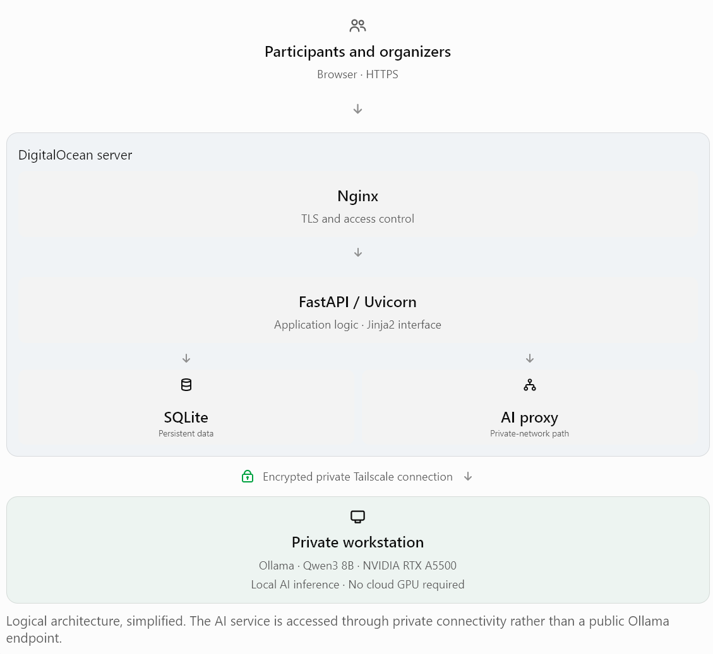

# Common Ground

## Technical Architecture and Implementation

*Resonance Technical Fellowship | October 2026*

## 1. Executive Overview

Common Ground is a functional, web-based prototype designed to help community organizers convene gatherings, collect participants' questions and ideas, prepare agendas, and explore how artificial intelligence can support constructive conversations.

The application demonstrates a deliberately lightweight architecture combining established open-source technologies with a locally operated, open-weight language model.

The system is deployed on an existing DigitalOcean server, while its AI inference capability runs on privately operated hardware. An encrypted private network connects the two environments.

This arrangement separates application hosting from AI computation, demonstrating that organizations can experiment with useful AI capabilities without committing to expensive cloud GPU infrastructure or proprietary inference services.

### Design principles

- Keep the application understandable, maintainable, and affordable.
- Preserve human responsibility for interpreting and acting on participant contributions.
- Minimize external dependencies and unnecessary data sharing.
- Favor widely available tools and reproducible deployment.
- Treat security, privacy, and operational reliability as essential design concerns.
- Support incremental improvement without prematurely introducing enterprise-scale complexity.
## 2. Application Architecture

Common Ground uses a Python web application with server-rendered HTML and a lightweight relational database.

### Core technologies

| Component | Implementation |
| --- | --- |
| Application framework | Python 3.12, FastAPI |
| Application server | Uvicorn |
| User interface | Jinja2 templates, HTML, CSS, JavaScript |
| Database | SQLite |
| Containerization | Docker Compose |
| Web hosting | DigitalOcean Linux droplet |
| Web entry point | Nginx with HTTPS |
| Private connectivity | Tailscale |
| AI inference | Ollama |
| Language model | Qwen3 8B, open-weight |
| Version control | Git and GitHub |
| Testing | Automated Python and JavaScript test suites |

The application supports two primary workflows.

### Participant workflow

Participants access a gathering through the web interface, review its information, register to attend, and submit questions or ideas for consideration.

The interface is designed to make participation straightforward without requiring an individual participant account.

### Organizer workflow

An authorized organizer creates and maintains gatherings, reviews submissions, structures agendas, manages resources, and exports relevant information.

Host administration also supports gathering status management, including cancellation and restoration.

Organizers remain responsible for deciding how contributions are interpreted, presented, and used.

## 3. Deployment and Network Design

The hosting, proxy, private-network, and workstation details below and in the diagram describe the supplied deployment context. They are not provisioned or independently verifiable from this repository. The checked-in Compose configuration binds the web service to `127.0.0.1:8000` and defaults to `http://host.docker.internal:11434` for Ollama; the isolated reviewer configuration defaults to an offline endpoint. See [operator boundaries](OPERATIONS.md).

The prototype operates across two computing environments.

### Cloud application environment

An existing DigitalOcean droplet hosts the Common Ground web application in a dedicated Docker Compose project.

Nginx provides the HTTPS entry point, while the application container listens on a local interface rather than exposing its application port directly to the public internet.

SQLite data is maintained in persistent storage independent of the container lifecycle.

The deployment shares physical server resources with unrelated applications but maintains separate application services and configuration.

### Privately operated AI environment

Ollama runs on a privately operated workstation with an NVIDIA RTX A5500 GPU.

The Qwen3 8B model performs inference locally. The cloud application communicates with this service over a private Tailscale network, using an HTTPS forwarding arrangement.

The Ollama service is not intentionally exposed as a public internet endpoint.

The architecture follows this general request path:

1. A participant or organizer accesses the HTTPS web application.
1. Nginx forwards authorized requests to the FastAPI service.
1. FastAPI performs application logic and accesses SQLite as appropriate.
1. For an AI-assisted operation, the application contacts its configured Ollama endpoint through the private network.
1. The model generates a response that the application presents for human review or further action.
The cloud server does not require a dedicated GPU. AI inference is supplied by the separate workstation.

This design also makes the model service a replaceable component, subject to interface compatibility and the performance requirements of alternative models.

## 4. AI Integration and Human Oversight

Common Ground uses Ollama to provide access to a locally operated language model.

The prototype includes AI-assisted theme generation as part of its exploration of community discussion support.

The broader opportunity is to help organizers identify recurring concerns, explore relationships among submitted questions, and prepare for discussions involving diverse perspectives.

However, language-model output is an interpretation, not an authoritative statement of what participants believe.

The intended operating principles are:

- Preserve the distinction between original participant contributions and generated interpretations.
- Keep organizers responsible for reviewing AI-generated material.
- Avoid treating AI-generated themes as a replacement for participant judgment.
- Evaluate the accuracy, fairness, and usefulness of AI assistance during actual community use.
Local inference offers architectural flexibility and limits dependence on external inference providers. It does not, by itself, guarantee privacy, fairness, or freedom from model errors.

Those properties require appropriate application controls, operating procedures, and continued evaluation.

## 5. Data Management, Security, and Reliability

The prototype uses SQLite to store gathering information, participant registrations, submitted questions, agendas, and associated application data.

The database resides in persistent container storage. Database backup procedures have been implemented and tested, including integrity and foreign-key consistency checks.

### Security controls and boundaries

The prototype includes password-protected organizer access, request validation, and CSRF protections for relevant form operations.

The public application entry point uses HTTPS. Application services and private AI connectivity are separated from direct public access.

Participant registration information and submitted questions are handled as distinct categories of information, including separate administrative exports.

The application does not rely on external commercial AI APIs for inference, and its design avoids external tracking and telemetry services.

These decisions reduce some exposure risks, but the prototype should not be represented as a fully audited, production-grade multi-tenant platform.

### Known limitations

The present administrative model uses shared-password authorization rather than individual organizer accounts with granular permissions.

The privately operated model service introduces an availability dependency: AI functions depend on the workstation and private network being reachable.

SQLite is appropriate for the current scale and operational simplicity but would merit reevaluation if concurrency, multi-organization isolation, or deployment requirements expand substantially.

Future use involving real participants should include a proportionate privacy, retention, access-control, and security review.

## 6. Engineering Validation and Reproducibility

Development uses Git for version control, Docker Compose for repeatable execution, and automated testing to verify application behavior.

Previously reported validation includes (historical results, not a fresh test run for this document review):

- 411 passing Python tests.
- 72 passing JavaScript tests.
- Verified database integrity and foreign-key consistency.
- Repeatable fictional demonstration data.
- A Git repository with reviewed source and documentation changes.
- Exclusion of database files, backups, credentials, and model files from the intended source distribution.
A fresh database starts with one fictional Library gathering and no questions or RSVPs. Applying the optional demonstration manifest to an untouched fresh database produces six gatherings and 60 fictional questions in total. Seven gatherings and 94 questions described an earlier developer-local database, not the shipped dataset. See [demonstration seeding and reset safety](DEMO_SEEDING.md).

Development and cloud deployment have both been exercised, including connectivity to the private Ollama service.

The GitHub repository is intended to provide the application source, deployment guidance, test instructions, and supporting documentation. Before public release, the repository and its history require a final review for confidential information and environment-specific secrets.

## 7. Technical Tradeoffs and Future Development

Several architectural decisions were made to keep the prototype achievable, inspectable, and maintainable.

SQLite instead of a database server: reduces deployment and administration overhead while meeting current prototype requirements.

Server-rendered HTML instead of a large front-end framework: keeps the application relatively simple, with fewer build and runtime dependencies.

Existing cloud hosting instead of a dedicated deployment: demonstrates that the web application can run with modest infrastructure.

Private GPU inference instead of a commercial AI API: provides direct experience operating an open-weight model while avoiding per-request commercial inference charges.

Human-guided interpretation instead of autonomous decision-making: keeps community judgment central to the application.

Possible future development includes more granular organizer permissions, stronger data-governance controls, accessibility evaluation, expanded AI-assisted analysis, and more flexible deployment options.

These are possibilities for evaluation, not commitments that should supersede the priorities of a fellowship or its participants.

## 8. Relationship to the Resonance Fellowship

Common Ground is a working technical demonstration, not a prescribed work plan for Resonance.

It illustrates the ability to turn a collaborative social concept into an operational software system using practical open-source tools and locally operated AI.

The fellowship would provide an opportunity to apply this experience to the priorities established by Resonance and its participants. Whether Common Ground itself becomes relevant to that work is a decision to be made collaboratively.

The most important contribution is therefore not any single software component. It is the combination of systems engineering, iterative development, operational experience, and a commitment to ensuring that technology remains accountable to the people it serves.

The goal is not to make communities dependent on AI. It is to discover where appropriate technology can strengthen their capacity to work together.

